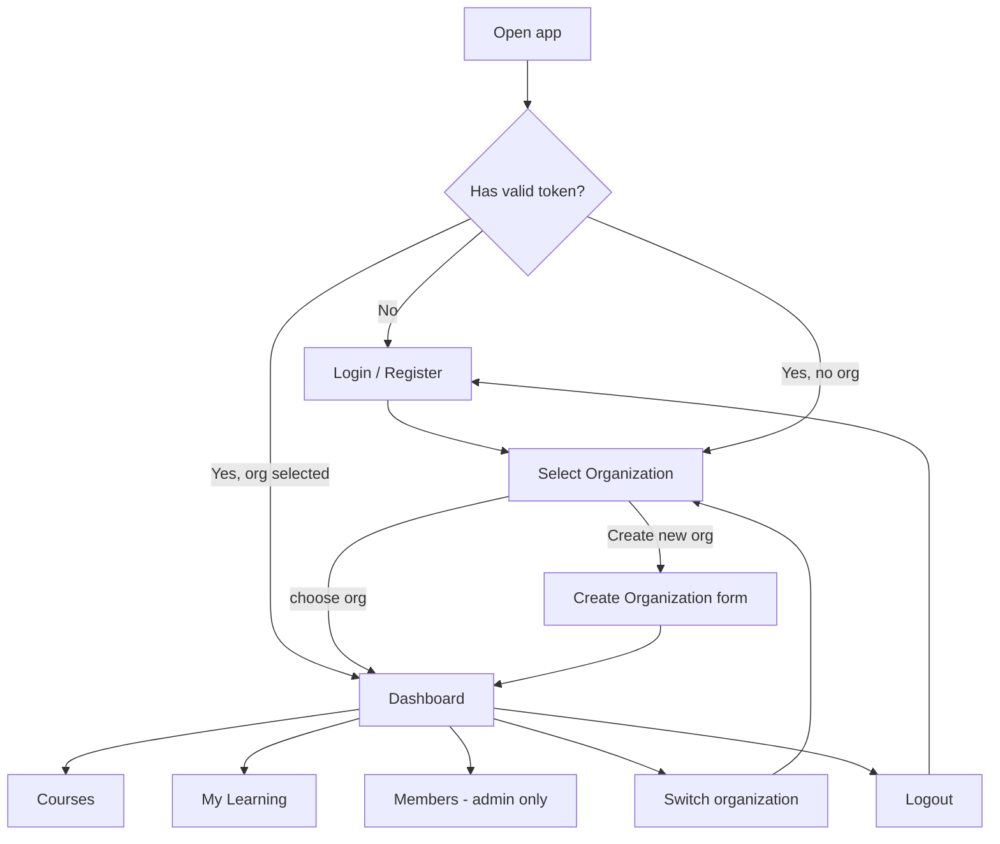

# App Flow Document

**Product:** OrgLearn — Multi-Org Learning Platform
**UI framework:** Streamlit (multipage app) · **Status:** Draft v1

---

## 1. Global Rules

- The JWT, selected organization and role are kept in `st.session_state`.
- **Guard on every page:** no token → redirect to Login. Token but no selected org → redirect to Select Organization.
- The sidebar (after org selection) shows: current organization name and role, navigation links allowed for that role, **Switch organization** and **Logout**.
- API errors are shown with `st.error`: 401 sends the user to Login; 403 shows "You don't have permission"; 404 shows "Not found".

## 2. High-Level Journey

## 3. Screens

### 3.1 Login / Register (`app.py`)
**Who:** anyone not logged in.
**Elements:** tabs "Login" and "Register"; email, password (and full name for register); submit button.
**Interactions**
| Action | Result |
|---|---|
| Submit Login (valid) | Store user token and org list → go to Select Organization |
| Submit Login (invalid) | Show "Invalid email or password" |
| Submit Register (valid) | Account created → switch to Login tab with success message |
| Register with existing email | Show "Email already registered" |

### 3.2 Select Organization (`pages/1_Select_Org.py`)
**Who:** any logged-in user.
**Elements:** a card or row per organization showing name and the user's role; "Enter" button on each; "Create new organization" expander (name field + button).
**Interactions**
| Action | Result |
|---|---|
| Click Enter | Call `select-org` → store org token, org name, role → go to Dashboard |
| Create organization | Call `POST /orgs` → org appears in list (user is admin) |
| User has no organizations | Empty-state message with the Create form |

### 3.3 Dashboard (`pages/2_Dashboard.py`)
Content depends on the role:

| Role | Shows |
|---|---|
| **Admin** | Member count, course count (draft/published), quick links to Members and Courses |
| **Instructor** | My courses (with status), enrollment counts, "Create course" button |
| **Learner** | My enrolled courses with progress bars, "Browse courses" button |

### 3.4 Courses (`pages/3_Courses.py`)
**Course list**
- Shows courses visible to the role (learners: published only; instructors: published + own drafts; admins: all).
- Each row: title, status badge, instructor name, button **Open**.
- Admin/Instructor: **Create course** button opens a form (title, description, status).

**Course detail (selected course)**
| Element | Admin | Instructor | Learner |
|---|:-:|:-:|:-:|
| Title, description, lesson list | ✅ | ✅ | ✅ |
| Enroll / Unenroll button | ✅ | ✅ | ✅ |
| Mark lesson complete | ✅ | ✅ | ✅ |
| Edit course, publish/unpublish, delete | ✅ | own only | ❌ |
| Add / edit / delete lessons | ✅ | own only | ❌ |
| Enrollment list | ✅ | own only | ❌ |

**Interactions**
| Action | Result |
|---|---|
| Open course | Fetch detail; if 404 show "Course not found" and return to list |
| Save new/edited course | API call → success toast → refresh list |
| Delete course | Confirmation checkbox, then API call |
| Enroll | Button changes to Unenroll; course appears in My Learning |
| Mark lesson complete | Lesson shows ✅; progress bar updates |

### 3.5 My Learning (`pages/4_My_Learning.py`)
**Who:** all roles.
**Elements:** list of enrolled courses with progress %, a "Continue" button that opens the course detail. Empty state: "You haven't enrolled in any course yet" with a link to Courses.

### 3.6 Members (`pages/5_Members.py`)
**Who:** admin only. Other roles see "Admins only" and are redirected to Dashboard.
**Elements:** members table (name, email, role); "Add member" form (email + role); per-row role dropdown and Remove button.
**Interactions**
| Action | Result |
|---|---|
| Add member (user exists) | Added with chosen role |
| Add member (unknown email) | "No user with that email" |
| Add member (already in org) | "Already a member" (409) |
| Change role / Remove | API call; refresh table |
| Demote or remove last admin | Blocked: "An organization must have at least one admin" |

### 3.7 Switch Organization / Logout (sidebar)
- **Switch organization:** clears org token, org name and role from session state (keeps the user token) → Select Organization.
- **Logout:** clears all session state → Login.

## 4. Key User Flows

### Flow A — First-time user creates an organization and a course
1. Register → Login
2. Select Organization → Create new organization ("Demo Academy") → Enter (role: admin)
3. Dashboard → Courses → Create course (draft) → add two lessons → Publish

### Flow B — Learner in a second organization
1. Login → Select Organization → choose an org where the role is learner
2. Courses (published only) → Open → Enroll
3. Mark lessons complete → My Learning shows progress

### Flow C — Switching organizations (multi-org demo)
1. In Org A as admin, Courses shows Org A's courses
2. Sidebar → Switch organization → choose Org B (role: learner)
3. Courses now shows only Org B's published courses; Members page is no longer available

### Flow D — Permission edge cases (used in testing)
- Learner opens a course URL/id belonging to another org → "Course not found"
- Instructor tries to edit a colleague's course → "You don't have permission"
- Token expires → next action redirects to Login with "Session expired"

## 5. Navigation Map by Role

| Page | Admin | Instructor | Learner |
|---|:-:|:-:|:-:|
| Login / Register | ✅ | ✅ | ✅ |
| Select Organization | ✅ | ✅ | ✅ |
| Dashboard | ✅ | ✅ | ✅ |
| Courses | ✅ | ✅ | ✅ |
| My Learning | ✅ | ✅ | ✅ |
| Members | ✅ | ❌ | ❌ |

## 6. Empty, Loading and Error States

| State | Behavior |
|---|---|
| Loading | `st.spinner` during API calls |
| Empty list | Friendly message + the next action button |
| Network/API down | "Can't reach the server, please try again" |
| Validation error | Field-level message from the 422 response |
| Success | `st.toast` or `st.success`, then refresh data |

## 7. Demo Data (for the live demo)

| Email | Orgs and roles |
|---|---|
| admin@demo.com | Demo Academy (admin), Tech Institute (learner) |
| teacher@demo.com | Demo Academy (instructor) |
| student@demo.com | Demo Academy (learner), Tech Institute (instructor) |

Passwords listed in the README (demo only).
